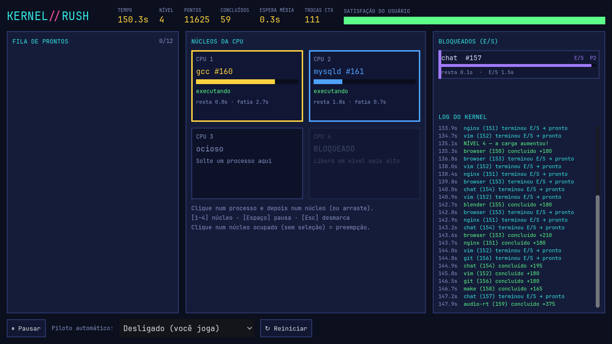

# KERNEL // RUSH

Jogo educativo 2D feito em **Godot 4.3** em que você é o **escalonador de CPU** de um sistema operacional. Processos chegam à fila de prontos e você decide quem roda em cada núcleo, sob pressão, enquanto lida com troca de contexto, E/S, tempo real e *starvation*.



## Como jogar

- **Clique** num processo e depois num núcleo, ou **arraste**. Atalhos: `1`–`4` escolhem o núcleo.
- Clicar num núcleo ocupado sem nada selecionado faz **preempção**: o processo volta ao fim da fila.
- Cada atribuição custa **0,4 s de troca de contexto**.
- `Espaço` pausa, `Esc` desmarca a seleção.
- Se a **satisfação do usuário** chegar a zero: *KERNEL PANIC*.

| Tipo | Aparece em | Comportamento |
|---|---|---|
| **CPU** | nível 1 | Burst longo, roda até terminar |
| **E/S** | nível 2 | Roda um pouco, bloqueia esperando o dispositivo e volta para a fila |
| **Tempo real** | nível 3 | Tem **prazo**: perder custa −15 de satisfação |

A cada 45 s o nível sobe e os processos chegam mais rápido. Novos núcleos são liberados nos níveis 3 e 5.

### Piloto automático

O seletor no rodapé põe um algoritmo clássico para jogar no seu lugar, para você comparar com a sua estratégia:
**FCFS**, **SJF**, **Round Robin** (quantum 1,5 s), **Prioridade** e **EDF**. Partidas com piloto automático não contam para o recorde.

## Conceitos de SO no jogo

| Conceito | Onde aparece |
|---|---|
| Fila de prontos / estados de processo | Colunas *Fila*, *Núcleos* e *Bloqueados* |
| Troca de contexto | Atraso de 0,4 s a cada atribuição |
| Preempção | Clicar num núcleo ocupado; Round Robin |
| Starvation | Barra de espera e processos "tremendo" |
| Processos I/O-bound vs CPU-bound | Tipos E/S e CPU |
| Escalonamento de tempo real | Prazos e o algoritmo EDF |
| Métricas | Espera média, turnaround e trocas de contexto |

## Rodando o projeto

1. Instale o [Godot 4.3](https://godotengine.org/download) (versão padrão, sem .NET).
2. Abra o Godot, clique em **Importar** e selecione o `project.godot`.
3. Aperte **F5**.

### Testes da simulação (headless)

```bash
godot --headless --path . --import
godot --headless --path . -s tests/test_sim.gd
```

### Versão web

Cada push na `main` roda os testes, exporta para HTML5 e publica no **GitHub Pages** (workflow em `.github/workflows/web.yml`).

## Estrutura

```
scenes/main.tscn      cena principal
scripts/sim.gd        simulação pura (sem UI), testável
scripts/main.gd       interface e loop do jogo
scripts/proc_card.gd  cartão de processo (arrastável)
scripts/core_slot.gd  núcleo da CPU (alvo do drop)
scripts/ui_style.gd   paleta e estilos
tests/test_sim.gd     testes headless
tests/screenshot.gd   gera capturas de tela (precisa de display)
```

## Próximas ideias

- Mundos novos: **memória** (paginação/substituição), **concorrência** (deadlock) e **disco** (SCAN/C-SCAN).
- Gráfico de Gantt ao fim da partida.
- Efeitos sonoros e arte em pixel art própria.
